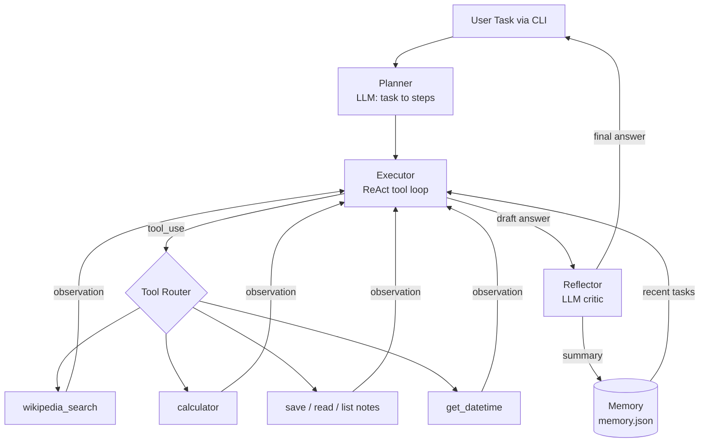

# 🤖 Agentic Research Agent

An autonomous AI agent that **plans**, **acts with tools**, **observes**, and **self-reflects**
to complete multi-step tasks. Built with Python and the Claude API (tool use).

## Features
- **Planner** – decomposes a goal into 2–5 steps
- **Executor (ReAct loop)** – chooses tools, reads results, repeats until done (max 10 steps)
- **Reflector** – critiques and improves the draft answer before returning it
- **Tools** – Wikipedia search, safe calculator, notes (save/read/list), date & time
- **Long-term memory** – past task summaries stored in `data/memory.json` and injected into context

## Architecture Schema



### Data flow (sequence)
1. User submits a task.
2. Planner returns a JSON list of steps.
3. Executor sends task + plan + memory to the LLM with tool schemas.
4. If the LLM returns `tool_use`, the Tool Router runs the function and returns a `tool_result`.
5. Loop continues until the LLM gives a final text answer.
6. Reflector verifies/improves the answer; a summary is saved to memory.

### Folder structure
```
agentic-research-agent/
├── main.py            # CLI entry point
├── agent/
│   ├── core.py        # Planner, Executor, Reflector
│   ├── tools.py       # Tool schemas + implementations
│   └── memory.py      # JSON long-term memory
├── tests/test_tools.py
├── requirements.txt
└── .env.example
```

## Setup
```bash
git clone <your-repo-url>
cd agentic-research-agent
python -m venv venv && source venv/bin/activate   # Windows: venv\Scripts\activate
pip install -r requirements.txt
cp .env.example .env        # add your ANTHROPIC_API_KEY
python main.py "Find the population of Chennai and compute 12% of it. Save a note."
```

## Example
```
Task> Summarise who Alan Turing was, then save it as a note called turing
[PLAN] 1. Search Wikipedia for Alan Turing  2. Summarise  3. Save note
[ACT] wikipedia_search({"query": "Alan Turing"})
[ACT] save_note({"title": "turing", "content": "..."})
=== FINAL ANSWER === ...
```

## Tests
```bash
pytest -q
```

## Safety
- Calculator uses AST parsing (no `eval`)
- Note filenames are sanitised (no path traversal)
- Step cap prevents infinite loops
